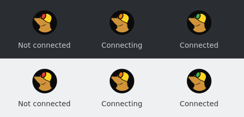
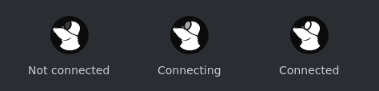

<p align="center">
  
</p>

<h1 align="center">Maze Mullvad Theme</h1>

<p align="center">The Maze Linux look for the Mullvad VPN desktop app.</p>

(Formerly `maze-mullvad-tray`; installing this package replaces it.)

- **Tray icons:** a black badge with the Mullvad mole in Mullvad colors; the lamp
  on its helmet shows the connection state.
- **Interface:** Mullvad's navy turned into Maze black — `#0b0b0b` backgrounds,
  with cards, buttons and the map in matching grays. Green, red and yellow status
  colors are untouched.
- **Logo:** the in-app logo, the window icon and the app menu icon use the same
  black badge.

## Tray icon

The lamp on the mole's helmet is the connection state, on dark and light panels:

<p align="center"></p>

| State | Lamp |
|---|---|
| Not connected | red |
| Connecting | orange |
| Connected | green |

While connecting, the lamp warms up from red to orange over Mullvad's ten
animation frames. When the app has a notification, a dot appears at the top
right (last icon):

<p align="center"></p>

With Mullvad's **Settings → User interface → Monochromatic tray icon** on, the
mole is white and the lamp goes from dark to white:

<p align="center"></p>

## Install

```sh
./build-pkg.sh
sudo pacman -U dist-pkg/maze-mullvad-theme-<version>-1-any.pkg.tar.zst
```

Then restart the Mullvad GUI: **Quit** from its tray menu and start it again.
The VPN connection is held by the daemon and is not affected.

To keep Mullvad's own interface colors and only change the icons, put
`THEME=0` in `/etc/maze-mullvad-theme.conf` and run
`sudo /usr/lib/maze-mullvad-theme/apply`.

Removing the package (`sudo pacman -R maze-mullvad-theme`) puts Mullvad's own
look back.

## How it works

Mullvad's GUI is an Electron app that `electron42` starts from
`/usr/lib/mullvad-vpn/app.asar`. Its Linux tray icons are the PNGs in
`build/assets/images/menubar-icons/linux/` inside that archive
(`lock-1` not connected, `lock-9` connected, `lock-10` connecting, `lock-2`…`lock-8`
the animation in between; see `tray-icon-controller.ts` in mullvadvpn-app).

This package does not run anything of its own. It changes files of the
installed `mullvad-vpn` package:

- `system/patch_asar.py` rewrites `app.asar` with the new icons and theme. Every
  other file stays byte for byte the same; the replaced files get new sizes,
  offsets and integrity hashes.
- `system/theme.py` maps Mullvad's color tokens (`color-tokens.ts`), the map
  colors (`3dmap.ts`), the window background and the navy in its SVGs to grays.
  If a Mullvad release no longer has the expected palette, the interface is left
  as it is rather than half themed.
- `system/apply` also replaces `/usr/share/icons/hicolor/*/apps/mullvad-vpn.png`
  (window and menu icon). It keeps a clean copy of those and of Mullvad's archive
  in `/var/lib/maze-mullvad-theme` and patches from it. It runs when this package
  is installed or upgraded, and from a pacman hook every time `mullvad-vpn` is
  installed or upgraded. If a Mullvad release renames its icons, the patch is
  skipped and Mullvad keeps its own look.
- `system/restore` puts Mullvad's archive and icons back when this package is
  removed.

`pacman -Qkk mullvad-vpn` reports `app.asar` and the icons as modified while this
package is installed; that is expected.

## Development

| File | What it is |
|---|---|
| `generate.py` | Draws the 40 tray icons and the app icon (needs `rsvg-convert` from librsvg) |
| `system/` | What the package installs: `apply`, `restore`, `patch_asar.py`, `theme.py`, the pacman hook |
| `packaging/` | `PKGBUILD` and the `.install` script |
| `tests/` | `python3 -m unittest discover -s tests` |
| `docs/make-images.sh` | Regenerates the images in this README (needs imagemagick) |
| `build-pkg.sh` | Runs the tests, renders the icons and builds the package into `dist-pkg/` |

The tests check the archive patcher, the theme mapping, the apply/restore cycle
(including a Mullvad upgrade in between), and that the icons and the theme fit
the installed Mullvad, so a Mullvad release that renames its icons or changes
its palette shows up at build time.

## Trademark

The mole is Mullvad's logo and a trademark of Mullvad VPN AB. Check Mullvad's
brand guidelines before distributing this package beyond your own machines.

## License

GPL-3.0, see [LICENSE](LICENSE).
